# SaaSFoundation — Meta Global AI Developer Hackathon submission brief

Updated November 5, 2026 (India). This is a preparation draft, **not confirmation that a project was submitted**.

## Identity

- **Product:** SaaSFoundation (previously Skeleton AI and LaunchBase; the repository URL remains `rahul-jain-dev/Lauchbase`).
- **Tagline:** From an idea to a buildable foundation.
- **Theme:** Build for Your World.
- **Suggested track:** Indie Developer, if that is the participant's registered track.
- **Repository:** https://github.com/rahul-jain-dev/Lauchbase
- **Submission source branch:** https://github.com/rahul-jain-dev/Lauchbase/tree/codex/submission-sprint
- **Live app URL:** _To be added after a successful deployment._
- **Demo video URL:** _To be added after recording, if requested by the submission portal._

These headings are preparation copy, not an assertion that the participant portal has these exact fields. The authenticated form and video limit are still needed.

## Target audience and solution

For freelancers translating client briefs into micro-SaaS projects, beginners choosing a first architecture, and solo founders defining an achievable first release. The working prototype turns a description into reviewable requirements and a grounded foundation plan. Its current deliverable is an architectural starting point and implementation preview, not generated application code.

## Technical architecture

The Next.js App Router/React/TypeScript UI collects requirements and presents editable understanding, confirmed scope and a project map. Shared Zod contracts validate application inputs, seven fixed analysis fields, additional scoped needs and recommendations. Server-only adapters send selected-provider requests; deterministic filtering eliminates incompatible catalog entries before ranking, and response validation rejects unsupported IDs, invented integrations and invalid evidence.

The catalog defines individual-user and team/client-portal foundations, including proposed Next.js/TypeScript and Supabase roles. Those proposed customer-app services are separate from the AI provider used by this prototype. Requirement importance, foundation coverage, workflow work and unsupported dependencies remain separate.

Settings credentials live only in expiring Node-process memory, with isolated opaque HttpOnly cookies and explicit test/activation. A single Node deployment is prepared in `render.yaml`; no hosted success is established until the actual URL and full session journey are tested.

```mermaid
flowchart LR
  Idea[Idea and builder constraints] --> Analysis[Selected model proposes requirements]
  Analysis --> Review[User reviews and confirms]
  Review --> Rules[Deterministic catalog filtering]
  Rules --> Ranking[Selected model ranks eligible options]
  Ranking --> Validation[Schema and catalog validation]
  Validation --> Plan[Foundation plan and project maps]
  Plan --> Preview[Build-plan preview]
```



Missing model configuration is shown explicitly; manual input/rules-only planning remains available. The diagram shows the configured AI workflow, not evidence that the current account has completed it.

## Current Meta evidence — November 5

The native adapter targets `https://api.meta.ai/v1/chat/completions` and the configured model is `muse-spark-1.3`. It uses the same validated analysis/ranking functions as the other adapters. Current `pnpm smoke:meta` **skipped** with `configuration_required` because no usable `META_API_KEY` is configured locally. No real Meta HTTP request ran in this check. Billing/authentication/model availability are therefore not established. This limitation must remain in the submitted integration description unless a later real check supplies evidence.

Official public event information describes Meta Model API and Meta open-weight models, including inference partners; it is not a substitute for the authenticated portal's binding integration requirements. No model/provider will be changed silently to satisfy a demo.

## Short description (draft, truthful at the current milestone)

SaaSFoundation helps first-time founders and freelancers turn a rough micro-SaaS idea into a realistic, explainable development foundation. It asks about the builder's experience, budget and requirements; uses a user-selected AI model to help interpret the idea; requires people to review assumptions; and compares supported architectural starting points with deterministic compatibility rules. The resulting interactive application and development maps explain which components are needed, what must still be implemented, and the setup and verification work that remains. Rather than presenting an AI-generated recommendation as a finished app, SaaSFoundation exposes trade-offs, blockers, unsupported capabilities and evidence.

## Problem and differentiation

Micro-SaaS beginners often receive confident but generic technology recommendations without regard to their experience, capabilities, cost constraints or security needs. SaaSFoundation keeps user-confirmed requirements separate from model-inferred guesses and uses a documented foundation catalog to prevent unsupported features from being silently promised. It makes a clear distinction between proposed infrastructure, essential product-specific workflows, missing integrations and verified functionality.

## Features already implemented in the inspected repository

1. Idea intake, builder-profile and budget choices, clarification and manual requirements review.
2. Named AI connection settings (Meta, Gemini, OpenAI, OpenRouter and approved gateways), with explicit model testing and selection; **direct Meta live success remains unverified**.
3. Hard-constraint filtering and ranking among a small catalog of individual SaaS and team/client-portal SaaS foundation **definitions**.
4. Explicit requirement confirmation, changes triggering reevaluation, and support/blocker disclosures.
5. Interactive application and development architecture maps with setup and verification notes.
6. Reviewable proposed build plan with modules, files, custom work, exclusions and next steps.

## Current non-features — never claim these in the submission

- The application does **not** generate runnable SaaS source code, ZIP archives, migrations or an installed project.
- It does **not** deploy a generated SaaS or establish that a generated foundation works.
- Saved-project persistence and hosted production readiness are **not** established.
- The latest repository notes document live OpenRouter representative checks with some semantic errors; they **do not** establish direct Meta API success.
- Distinguish historical Windows evidence from current sprint reruns in `IMPLEMENTATION_STATUS.md`. No fixture or local build proves a live hosted integration.

## Suggested honest demo flow (about two minutes)

1. Open SaaSFoundation and state the problem: beginners struggle to choose a SaaS starting point.
2. Enter an example idea, such as a client feedback portal for small design agencies, along with experience and budget.
3. Show requirements the app extracted versus questions it is uncertain about. Confirm or correct them manually.
4. Compare the supported foundations, showing why a team/client-portal structure is considered and what remains unsupported.
5. Open the architecture map and build-plan preview. Explain the boundaries between planned modules, user-specific workflows, and unverified integrations.
6. In Settings, show **a real Meta connection only if actual authorization, both model tests and inference have succeeded**. If using another provider, identify it accurately rather than imply Meta powered the demo.
7. End with what SaaSFoundation can do today and what is on the roadmap.

## Submission-day critical path

Current sprint verification: **164 unit/route tests and 22 desktop/mobile scenarios passed**, along with typecheck, lint and production build. Two browser scenarios exercise actual local production APIs without provider fixtures; others retain their documented fixture/manual boundaries. A production origin mismatch was reproduced and fixed across Settings, analysis, comparison and diagnostics, preserving foreign-origin rejection. This does not establish live Meta or public-hosting success. A silent, visibly labeled 33.72-second manual-input clip exists locally under `artifacts/submission-demo/`; it is fallback footage, not an uploaded final video.

- [ ] Confirm participant approval, track, and **exact submission fields** in the authenticated Cerebral Valley portal. An application alone does not establish acceptance.
- [ ] Confirm the posted project deadline: **November 4, 2026, 9:00 PM US Eastern = November 5, 2026, 7:30 AM IST**, unless the portal announces a change.
- [ ] Run `pnpm install --frozen-lockfile`, `pnpm typecheck`, `pnpm lint`, `pnpm test` and `pnpm build` in a real checkout.
- [ ] Connect Meta via Settings, test supported model operations and capture the actual model and result (never share or commit its secret key). If unavailable, describe the limitation openly.
- [ ] Deploy the existing planning demo with a persistent server runtime or suitable approved environment. Verify cookie/session behavior on the public URL; do not assume every serverless/edge deployment preserves in-memory keys.
- [ ] Run the complete user flow in the hosted URL, including refreshing, reconnecting and a new browser session.
- [ ] Record a concise video showing the real application and real model attribution, not simulated functionality.
- [ ] Fill only the submission fields that actually exist, attach verified links, and submit **before** the portal deadline. Confirm receipt on the portal.

## Developer run commands

Prerequisites: Node.js >= 22.12, pnpm 11.25.0.

```sh
pnpm install --frozen-lockfile
pnpm typecheck
pnpm lint
pnpm test
pnpm build
pnpm dev
```

For separate live direct Meta validation using locally secured credentials and intentional API calls: `pnpm smoke:meta`. The browser does not use those environment keys as a fallback. Set up and activate browser inference in Settings. Never include API keys in the submission.

## Official schedule source

https://dev.meta.ai/events/global-hackathon

Check the authenticated participant portal for binding rules and exact submission prompts. The public event page does not establish every form field.
