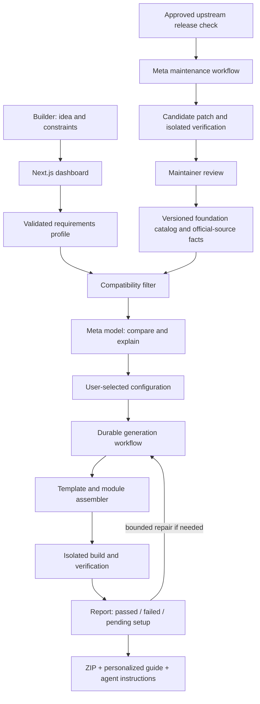

# LaunchBase — Meta AI Hackathon Project Plan

**Working name:** LaunchBase. Name availability has not been checked.  
**Plan date:** October 31, 2026.  
**Status:** Proposed implementation plan; no features are represented as already built.  
**Implementation workspace selected by the user:** `E:\Meta AI Hackathion`. This planning chat supplies prompts; a separate chat builds in that folder.  
**Audience:** Solo micro-SaaS builders and freelancers building small SaaS products for clients.  
**Event theme:** Build for Your World.  
**Submission deadline from the supplied participant guide:** November 4, 2026, 9:00 PM Eastern / November 5, 2026, 7:30 AM IST.

## 1. Product definition

LaunchBase turns a product idea and the builder's constraints into a suitable, runnable micro-SaaS foundation, personalized service-setup instructions, and a clear handoff for further development by a person or coding agent. It also maintains a small catalog of tested foundation versions.

**Product promise:** Describe what you want to build, your skills, budget, and constraints. Receive a working starting point, understand the technology choices, and know exactly how to configure and extend it.

“Best fit” means the best supported option among our evaluated configurations. It does not mean an exhaustive search of every technology or a guarantee of business success, security, or unlimited scale.

## 2. The problem

Micro-SaaS builders repeatedly face four related problems:

1. **Architecture uncertainty:** They must choose authentication, database, storage, billing, hosting, and background-processing services before understanding the consequences.
2. **Integration work:** A collection of popular tools is not necessarily a compatible, runnable application. Setup and wiring consume time before the distinctive product feature exists.
3. **Generic instructions:** Documentation often does not match the selected combination, the user's experience, or the version being installed. A coding agent also needs accurate conventions and extension points.
4. **Aging foundations:** Templates and instructions can become incompatible with upstream changes. Updating dependencies alone does not establish that the application still works.

These are problem hypotheses. Validate them with a small number of real builders during development; do not present estimated time savings as measured results.

## 3. The solution and its boundary

The user describes the product. LaunchBase asks the minimum necessary questions, produces a structured requirements profile, compares supported foundations, assembles a selected configuration, verifies it, and supplies a guided setup and extension plan.

The output is the foundation for the user's product. It includes a small working example of the relevant flow; implementing every unique business feature remains subsequent development.

Catalog maintenance is part of the MVP. Updating arbitrary customer-modified repositories is a later capability.

### Initial user journey

1. Enter an idea and builder profile.
2. Answer up to five targeted follow-up questions, with assumptions visible and editable.
3. Review a recommended foundation, alternatives, trade-offs, and unsupported requirements.
4. Select or revise the configuration.
5. Generate the project and watch real build/verification progress.
6. Follow the personalized setup checklist for external services.
7. Download the repository, architecture notes, coding-agent instructions, and verification report.
8. See the foundation's version, source provenance, and available catalog updates.

## 4. MVP features and priorities

| Priority | Feature | Concrete acceptance condition |
|---|---|---|
| Required | Idea and builder intake | Capture product goals, skill level, preferred stack, budget ceiling, deployment preferences, country/provider eligibility, account model, storage, billing, and background-processing needs. |
| Required | Targeted clarification | Missing information leads to relevant questions; assumptions remain visible and editable. |
| Required | Constraint-aware selection | Hard constraints eliminate incompatible options; the model explains trade-offs using catalog facts and dated official sources. Unsupported requests are explicitly identified. |
| Required | Foundation assembly | Generate two supported presets using versioned modules and configuration; produce a real ZIP with a lockfile and source attribution. |
| Required | Personalized setup guide | Show prerequisites, service creation steps, environment-variable names, migrations, validation commands, and troubleshooting for the exact selection. Beginner and concise views use the same underlying steps. |
| Required | Verification report | Separate static/build checks, integration checks, and user-completed setup. Store command results and timestamps. Never mark an unexecuted check as passed. |
| Required | Coding-agent handoff | Include architecture instructions, module contracts, extension examples, build/test commands, and a small product-specific implementation backlog. |
| Required | Catalog maintenance agent | Detect one supported upstream change, propose a patch, run checks, and create a reviewable candidate foundation version. Publishing is a separate maintainer action. |
| Required | Project dashboard | Persist requirements, selection, setup progress, artifacts, runs, and foundation version. |
| Stretch | File-processing preset | Add uploads plus a persistent background job with progress, retries, and example output. |
| Stretch | GitHub export | Create a repository after an explicit user action; ZIP export is the baseline. |
| Later | Customer-project migrations | Propose updates while preserving user modifications, with conflict handling and regression evidence. |
| Later | Wider stack selection | Add other frameworks and providers only after their configurations are integrated and verified. |

The platform's own paid subscription checkout, a template marketplace, automatic customer-service provisioning, voice UI, and unrestricted code generation are outside this hackathon MVP.

## 5. Supported foundations and technology selection

Support one TypeScript web stack family first. Prove meaningful differences in account structure, modules, schema, setup instructions, and example behavior rather than promising arbitrary stacks.

### Preset A — Individual-user SaaS

- Next.js, React, and TypeScript application.
- Supabase PostgreSQL and Supabase Auth.
- Individual account ownership, protected dashboard, and a small working CRUD example.
- Optional Stripe billing adapter with test coverage appropriate to available credentials.
- Setup guide and deployment instructions.

### Preset B — Team/client-portal SaaS

- The same supported web stack and managed database family.
- Workspaces, invitations, member roles, and tenant-scoped records.
- A working client-project flow; private file storage when selected.
- Isolation checks involving two distinct accounts/workspaces.
- Different schema, authorization requirements, setup steps, and coding-agent extension instructions from Preset A.

### Preset C — File-processing SaaS (stretch)

- Supabase private storage plus a persistent background-processing integration.
- Upload, queued/running/completed/failed state, bounded retry, and result retrieval.
- Include only if both required presets and catalog maintenance work end to end.

### Recommendation logic

Use deterministic compatibility filtering before model ranking. Consider user capability needs, existing accounts, experience, budget, hosting preferences, and regional availability. Then have the model explain the remaining choices against explicit facts.

Each technology/module record stores: purpose, supported version range, capabilities, requirements, incompatible combinations, provider/setup prerequisites, source URL, last-reviewed date, and verification status. Any pricing shown must include its source/date and assumptions; usage-based services are not represented as fixed-cost guarantees.

The MVP can explain a technology that is not yet implemented, but must label it advisory. It cannot export an untested combination as a verified foundation. For example, Neon may appear as an alternative PostgreSQL provider, but its generated-project adapter is a later task unless we implement and test it. If Python is a hard requirement, explain that the first catalog does not support it rather than silently selecting TypeScript.

## 6. Technology used to build LaunchBase

This is the platform stack, separate from the technologies it recommends to users. Pin compatible package versions and commit lockfiles after the initial integration checks; do not continually regenerate against floating `latest` versions.

| Layer | Chosen technology | Role |
|---|---|---|
| Web application | Next.js App Router, React, TypeScript | Intake, comparison, project dashboard, setup guide, and server endpoints. |
| UI | Tailwind CSS and shadcn/ui | Consistent forms, comparison tables, status panels, and accessible controls. |
| Runtime/package management | Compatible Node.js LTS and pnpm | One language/runtime family across web, orchestration, generator, and validation scripts. |
| Structured contracts | Zod and JSON Schema | Validate requirements, catalog entries, selected modules, tool arguments, generated setup plans, and model outputs. |
| Platform persistence | Supabase PostgreSQL | Projects, requirements, catalog versions, runs, setup progress, and verification records. |
| Platform identity and artifacts | Supabase Auth and private Supabase Storage | User sessions, per-user access, generated archives, and run evidence. |
| Reasoning models | Meta Model API: Muse Spark 1.3 and Muse Wonder 1.0 | Spark for intake/explanations; Wonder for difficult adaptation and maintenance repair. Confirm actual account access before depending on either. |
| Model integration | Server-side TypeScript adapter using HTTPS/fetch | Keep provider details centralized; support tool calling and schema-constrained output without an extra agent framework. |
| Workflow execution | Small explicit TypeScript state machine + Inngest | Durable generation/verification steps, bounded retries, resumable progress, and run identifiers. |
| Generator | Versioned template directories, typed manifests, deterministic file composition | Reuse known working code; generate schema/docs/config around approved contracts. |
| Code execution | Vercel Sandbox | Install, build, and run candidate projects in an isolated execution environment. |
| Local execution fallback | Disposable Docker containers | Alternative validation adapter if hosted sandbox access is unavailable; demonstrate the actual adapter used. |
| Application verification | Vitest, Playwright, TypeScript compiler, ESLint | Contract tests, browser flows, type checks, and lint checks. |
| Source/version management | Git and GitHub | Public submission, foundation tags, source attribution, and reviewable maintenance patches. |
| Scheduled catalog checks | GitHub Actions with manual and scheduled triggers | Check approved upstream releases and run the maintenance workflow; keep a manual trigger for the demo. |
| Web hosting | Vercel | Deploy the dashboard and API endpoints; long work runs through the durable workflow and execution adapters. |

The production application calls Meta models. Generated micro-SaaS applications need not include AI unless their requirements call for it. The MVP does not require fine-tuning, a vector database, Kubernetes, or several agent frameworks.

Official references: [Next.js installation](https://nextjs.org/docs/app/getting-started/installation), [Supabase SSR integration](https://supabase.com/docs/guides/auth/server-side/nextjs), [Inngest Next.js integration](https://www.inngest.com/docs/getting-started/nextjs-quick-start), [Vercel Sandbox](https://vercel.com/docs/sandbox), [Playwright](https://playwright.dev/docs/intro), [Vitest](https://vitest.dev/guide/).

## 7. Meaningful use of Meta AI

Meta documentation lists Muse Spark and Muse Wonder for coding, reasoning, and agentic work. The documented API model identifiers include `muse-spark-1.3` and `muse-wonder-1.0`; availability must be checked with our account. Wonder Full is not available through Model API. [Model reference](https://dev.meta.ai/docs/models), [quickstart](https://dev.meta.ai/docs/quickstart).

Use structured output for the requirements profile, selection explanation, setup plan, and proposed patch metadata. Treat schema validity as format validation, not proof that an architectural recommendation is correct. [Structured output](https://dev.meta.ai/docs/structured-output).

Expose narrow tools for reading approved catalog/source information, rendering a preset, checking compatibility, starting validation, reading results, and proposing changes inside a candidate workspace. The application executes tools and enforces permissions; model messages cannot directly execute code or publish releases. [Tool calling](https://dev.meta.ai/docs/tool-calling).

Use one orchestrated workflow with stage-specific responsibilities rather than several independent chat personalities. Store concise decisions, source references, tool events, and observable results; private model reasoning is not a product artifact.

Record actual model usage, token counts when supplied by the API, tool calls, and run outcomes. Cache catalog documents, avoid sending entire repositories when a few files suffice, and cap repair attempts. The participant's Meta credits do not cover unrelated hosting, sandbox, database, or payment-provider charges.

## 8. Architecture and data flow



### Core records

- `projects`: owner, description, status, current selected release.
- `requirement_profiles`: structured constraints, assumptions, clarification answers, revisions.
- `catalog_releases`: version, module versions, source references, lifecycle state.
- `recommendations`: candidate configuration, rationale, eliminated options, unresolved requirements.
- `generation_runs`: stage, idempotency key, attempts, model usage, artifact identifiers.
- `verification_checks`: exact command/check, execution environment, outcome, timestamp, evidence.
- `setup_steps`: prerequisites, instructions, completion status, actual check status.
- `artifacts`: archive, docs, checksums, owning project.
- `maintenance_runs`: upstream change, candidate patch, results, review and publication state.

Use per-owner access policies. Platform administration and catalog publication are separate from ordinary project ownership.

## 9. Personalized instructions and exported project

If Supabase is selected, the guide tells the user why, which services they need, what configuration to create, how to supply values locally, how to run migrations, and how to test the actual connection. Instructions link to the relevant official documents and match the generated release.

Track three independent statuses: **code verified**, **external service configured**, and **integration verified**. A successful build with placeholders cannot establish that a customer's live database or checkout is connected.

An exported project contains:

```text
generated-project/
  app/                    # Selected UI, routes, and working example
  modules/                # Included supported modules only
  supabase/migrations/    # Schema and access policies where selected
  tests/                  # Relevant contract and browser checks
  scripts/doctor.ts       # Environment and connection checks
  docs/ARCHITECTURE.md
  docs/SETUP.md
  docs/DECISIONS.md
  docs/BUILD_NEXT.md
  docs/VERIFICATION.md
  AGENTS.md
  foundation.manifest.json
  .env.example
  package.json
  pnpm-lock.yaml
  README.md
  LICENSE
  THIRD_PARTY_NOTICES.md
```

The manifest identifies the exact foundation version, selected modules, configuration, source commits where applicable, and check results. The extension guide identifies which areas the builder should customize and which contracts must remain intact.

## 10. Maintenance design

1. Check a small allowlist of package or provider releases and official documentation. Start with one supported adapter/update path.
2. Compare the candidate change with the existing pinned foundation and identify affected modules and instructions.
3. Have the Meta model propose a patch and an explanation tied to the actual upstream change.
4. Build a candidate release in isolation and execute relevant checks.
5. Allow up to two repair attempts, then stop with actionable failure evidence.
6. Produce a reviewable diff, test report, updated setup instructions, and proposed version.
7. Keep failed candidates outside the stable catalog. A maintainer explicitly publishes a passing candidate.

For the demo, use a clearly labeled controlled compatibility change in a sample adapter. The model must actually diagnose and patch it. Explain that this proves the repair mechanism; it is not proof of comprehensive ecosystem monitoring or automatic migration of customized customer products.

## 11. Practical integration boundaries

- Use the user's chosen accounts through explicit setup steps. The MVP does not create paid services or apply production migrations automatically.
- Keep the Meta API key server-side. Export environment-variable placeholders rather than service credentials.
- Validation runs receive disposable test resources. Do not provide platform administration credentials to generated code or model context.
- Apply schema and tenant-isolation checks to team foundations. Supabase documents row-level access controls for both database and storage. [Database policies](https://supabase.com/docs/guides/database/postgres/row-level-security), [storage policies](https://supabase.com/docs/guides/storage/security/access-control).
- Support Stripe as an optional test integration when an account is available. A test fixture is labeled simulated; it cannot count as a live provider check. [Stripe testing](https://docs.stripe.com/testing).
- Include country/account eligibility in recommendations. For example, Stripe currently documents invite-only access for new Indian accounts; do not make immediate Stripe onboarding a universal promise. An unsupported provider requirement becomes a visible limitation. [Stripe account availability in India](https://support.stripe.com/questions/stripe-accounts-are-invite-only-in-india).
- Use our own newly built modules or properly licensed third-party foundations, preserve attribution, and identify hackathon contributions clearly.

## 12. Build schedule — October 31 to November 4, IST

The dates are a target sequence, not a claim of completed work. Validate model, database, workflow, sandbox, and hosting access at the beginning. Make ZIP export independent of GitHub account integration.

| Date | Build target | Exit condition |
|---|---|---|
| Oct 31 | Core schemas, catalog manifest, Next.js dashboard shell, platform persistence, Meta adapter, and Preset A | One real idea produces a validated profile and one generated preset that builds locally. |
| Nov 1 | Preset B, compatibility rules, comparison UI, personalized setup documents, and agent handoff | Both foundations generate; workspace isolation is exercised; a hard constraint is correctly rejected. |
| Nov 2 | Durable runs, isolated validation, progress reporting, artifact storage, ZIP export, and setup doctor | Fresh generated projects run their documented checks; pending external setup is represented honestly. |
| Nov 3 | One maintenance path, bounded repair, candidate releases, and evidence collection | Controlled breaking change produces a real diagnosis, patch, and rerun; failed versions cannot become stable. |
| Nov 4 | Feature freeze, end-to-end verification, user feedback, public deployment, documentation, demo recording, and submission | Public repo and video work; both example apps and maintenance evidence are accessible; submission completed with margin. |

If behind schedule, cut the third preset, GitHub export, extra providers, and presentation extras first. Preserve one complete intake-to-running-project path, the second required preset, accurate setup guidance, and the maintenance proof. Avoid expanding into arbitrary stacks during the event.

## 13. Definition of done and evaluation

Release only supported combinations that have passed their relevant checks. Use meaningful tests for compatibility rules, template composition, tenant isolation, and successful/failing setup cases.

Required demonstration evidence:

- The same base idea with two different builder profiles yields explainably different module/account choices.
- Both required presets install and build from their exported archives in a clean environment.
- An authenticated user can create and retrieve an example record.
- Two different workspaces cannot read each other's protected records.
- A missing configuration value and a broken connection produce actionable setup guidance.
- Optional payment-provider checks clearly distinguish fixture, test-provider, and unverified states.
- An unsupported hard requirement is not silently ignored.
- One maintenance candidate fails, receives a real model-proposed fix, and passes the relevant rerun.
- The system exposes actual sources, timestamps, template versions, and check outcomes.

Measure generation duration, time to the first successful documented flow, number of manual corrections, unsupported-combination handling, and repair success on the controlled case. Report the observed sample and conditions; do not extrapolate to all apps or advertise unmeasured percentage savings.

## 14. Three-minute demo

| Time | Evidence |
|---|---|
| 0:00–0:20 | Explain the builder's problem and enter a specific micro-SaaS idea. |
| 0:20–0:45 | Show targeted questions and two contrasting builder profiles. |
| 0:45–1:10 | Explain selected modules, provider trade-offs, and one excluded option. |
| 1:10–1:50 | Open the real generated project, personalized setup guide, and executed verification report; demonstrate its core behavior. |
| 1:50–2:15 | Show the second preset and its genuinely different account structure or workflow. |
| 2:15–2:45 | Show the controlled maintenance failure, actual patch, and passing rerun. Use clearly identified recordings when a run is too long for the video. |
| 2:45–3:00 | Show source/version provenance, extension handoff, and the final value proposition. |

## 15. Positioning, competition, and hackathon fit

The individual ingredients are established. ShipFast and supastarter offer SaaS foundations, including agent-oriented features; Copier supports template evolution. Our proposed distinction is the connected experience of constraint-based selection, verified assembly, personalized onboarding, and demonstrated catalog maintenance. Validate that advantage rather than claiming a new category. [ShipFast](https://shipfa.st/), [supastarter](https://supastarter.dev/), [Copier](https://copier.readthedocs.io/en/stable/updating/).

Use the supplied Meta rubric to evaluate the entry:

- **Impact:** Show a builder reaching a useful working foundation and document actual setup friction removed.
- **Use of Meta tooling:** Show real requirements analysis, tool-driven adaptation, and maintenance repair with Meta models.
- **Technical depth and execution:** Demonstrate compatibility contracts, isolated execution, tenancy verification, and versioned releases.
- **Demo:** Show working code and evidence of outcomes in a concise narrative.

Prepare a public repository, accessible three-minute video, all contributor names, attribution, reproducible demo instructions, and a clear account of what was built during the hackathon. This plan is for the Meta event; demonstrating two applications is our chosen proof of versatility, not a claim that Meta has a Skeleton Crew category.

## 16. Initial setup dependencies and budget

Needed accounts/access: Meta Model API with credited usage and working model access, Supabase, GitHub, Vercel, and Inngest. Verify sandbox access and actual billing before relying on hosted execution; Docker is the local adapter alternative. Optional payment integration depends on an available test account.

Record actual provider usage. Allocate the $150 Meta credit as a spending envelope rather than assuming unlimited runs: approximately $75 for development, $45 for validation and repair experiments, $15 for demo runs, and $15 reserve. These are planning allocations, not verified model-price estimates or a promise that the whole product fits free tiers. Apply a per-run token/tool/repair budget and display estimates separately from actual reported usage. Hosting, sandbox, storage, and other providers are separate costs. [Sandbox billing reference](https://vercel.com/docs/sandbox/pricing).

## Recommended first milestone

Build a single complete vertical slice: **idea → validated profile → supported selection → generated Preset A → isolated build → personalized setup guide → downloadable archive**. Once this works with a real Meta call and real execution evidence, add the second preset and the maintenance proof.
